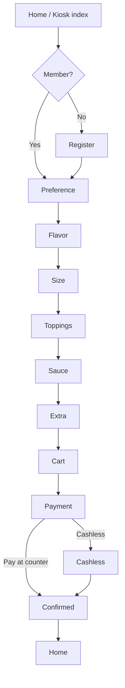

# CreamByte Kiosk — Project Flow

Detailed, structured flow documentation for the CreamByte kiosk web app.

## 1. Project Snapshot

- **Type:** Static front-end kiosk + scaffolded backend (Node/Express-style structure).
- **Frontend:** `frontend/` — kiosk pages live under `/frontend/src/*` (served as static files).
- **Backend:** `backend/` — API entrypoint, routes, controllers, middleware, services (auth scaffold).
- **State:** Currently browser-only for the kiosk UI (`localStorage` / `sessionStorage` in `app.js`); backend will own member/auth/orders persistence.

## 1.1 Root-level safety files

```
.gitignore      # ignores node_modules, build output, .env, logs, IDE/OS files
.env.example    # template for auth/server secrets (copy to .env, which is gitignored)
docs/           # flow documentation (e.g. FLOW.md)
```

## 2. Current Project Structure

```
creambyte/
├── backend/                        # Backend (scaffold)
│   ├── server.js                    # API entrypoint (scaffold)
│   ├── routes/
│   │   └── index.js                 # API routes (scaffold)
│   ├── controllers/
│   │   └── auth.controller.js      # Auth controller (scaffold)
│   ├── middleware/
│   │   └── auth.middleware.js      # Auth middleware (scaffold)
│   └── services/
│       └── member.service.js       # Member service (scaffold)
├── frontend/                        # Frontend (static kiosk)
│   ├── src/
│   │   ├── index.html              # Home / entry page
│   │   ├── register.html           # Member sign-up
│   │   ├── preference.html        # Dine-in vs Takeaway
│   │   ├── flavor.html            # Step 1/5 — flavor
│   │   ├── size.html               # Step 2/5 — size
│   │   ├── toppings.html           # Step 3/5 — toppings
│   │   ├── sauce.html              # Step 4/5 — sauce
│   │   ├── extra.html              # Step 5/5 — extras
│   │   ├── cart.html               # Review items / totals
│   │   ├── payment.html            # Payment method
│   │   ├── cashless.html           # Cashless payment options
│   │   ├── confirmed.html          # Order confirmation / points
│   │   ├── app.js                  # ALL application logic (single IIFE, no modules)
│   │   ├── styles.css              # Global kiosk styles (connected via <link> in every page)
│   │   ├── assets/                 # Static assets (creambyte-logo.png favicon, mascot, SVGs)
│   │   └── css/                    # Page-specific stylesheets
│   │       base, home, flavor, size, toppings, sauce, extra, customize,
│   │       cart, payment, cashless, confirmed, preference, register, ...
├── docs/
│   └── FLOW.md                      # this flow documentation
├── .gitignore                       # ignores node_modules, dist, .env, logs, IDE/OS files
└── .env.example                     # auth/server secret template (copy → .env, which is gitignored)
```

### Frontend ↔ Backend wiring notes

- Frontend static assets currently reference `/frontend/src/...` (absolute from web root, served from the `frontend/` folder).
- When the backend serves the frontend, mount `frontend/` as static (e.g. `app.use(express.static(path.join(__dirname, "../frontend")))`); asset URLs are already prefixed with `/frontend/src/...`.

## 3. High-Level Order Flow



**Simplified happy-path page sequence:**

```
Home → Preference → Flavor → Size → Toppings → Sauce → Extra → Cart → Payment → Confirmed → Home
```

## 4. Stage-by-Stage Flow

### 4.1 Home (`index.html`) — `data-page="home"`

| #   | Action                        | Result                                                                             |
| --- | ----------------------------- | ---------------------------------------------------------------------------------- |
| 1   | Arrives / reloads             | Renders saved member welcome if `state.member` exists (`{name} · {points} points`) |
| 2   | Click **"Order as guest"**    | Sets `state.activeMember = null`, saves, navigates to `preference.html`            |
| 3   | Click **"Create an account"** | Navigates to `register.html`                                                       |

### 4.2 Register (`register.html`) — `data-page="register"`

- Inputs: 6-digit Member ID (`/^\d{6}$/`), Name, Password (≥ 8 chars).
- Validation failure → shows `#form-error`, stays on page.
- Success:
  - Resolves existing member (`state.member.id === id ? state.member.points : 0`).
  - Writes member to **localStorage** (`creambyte.member.v1`).
  - Resets `draft`, `unlockedStep = 0`, `orderComplete = false`.
  - Navigates to `preference.html`.

### 4.3 Preference (`preference.html`) — `data-page="preference"`

- Shows greeting if a member is active (`Hi, {name}!`).
- Chooses service type:
  - **Dine-in** (`data-order-type="Dine-in"`)
  - **Takeaway** (`data-order-type="Takeaway"`)
- On choice: resets `draft`, sets `unlockedStep = 0`, navigates to `flavor.html`.

### 4.4 Build Steps (5 sequential customization steps)

Pages: `flavor`, `size`, `toppings`, `sauce`, `extra` (each: `data-page="<step>"`).

Shared behavior (driven by `app.js`):

- Step order: `["Flavor", "Size", "Toppings", "Sauce", "Extra"]` ↔ route slugs `["flavor", "size", "toppings", "sauce", "extra"]`.
- Progress indicator shows `n / 5`, progress bar width = 20%·n.
- `#continue-step` is **disabled** until `state.draft[step]` has a value.
- Flavor renders **two option groups**: "Limited Edition" and "Classic".

| Step | Heading              | Options source             | Continue label       |
| ---- | -------------------- | -------------------------- | -------------------- |
| 1    | Choose your flavor   | `OPTIONS.Flavor` (grouped) | Continue             |
| 2    | Choose your size     | `OPTIONS.Size`             | Continue             |
| 3    | Choose your toppings | `OPTIONS.Toppings`         | Continue             |
| 4    | Choose your sauce    | `OPTIONS.Sauce`            | Continue             |
| 5    | Choose your extras   | `OPTIONS.Extra`            | **"Add to order →"** |

Navigation rules:

- **Forward:** Continue → unlock next step (`unlockedStep = max(unlockedStep, index + 1)`) → go to next step slug.
- **Backward:** `#[data-back]` → previous step slug; from `flavor` goes to `preference.html`.
- **Step gating:** if current route index > `state.unlockedStep`, redirect to `/frontend/src/${STEP_PAGES[unlockedStep]}.html`.

Final step action (`addConfiguredItem`):

- Requires `state.draft.Flavor` (otherwise no-op).
- Pushes item: `{ id, orderType, flavor, size, topping, sauce, extra, price: currentPrice(), quantity: 1 }`.
- Resets `draft = EMPTY_SELECTION()`, `unlockedStep = 0`.
- Navigates to `cart.html`.

### 4.5 Cart (`cart.html`) — `data-page="cart"`

- Empty state → auto-redirect to `preference.html`.
- Renders item count, per-item cards (flavor art, line total, unit price, service/size/topping/sauce/extra details, quantity +/− controls, remove).
- Totals: **Subtotal**, **VAT (12%)**, **Total**.
- `#checkout` → `payment.html` (disabled when no items).
- **"＋ Add another treat"** → resets draft + unlocked step → `preference.html`.

### 4.6 Payment (`payment.html`) → Cashless (`cashless.html`) → Confirmed (`confirmed.html`)

```
cart --> payment --> (Pay at counter | Cashless) --> cashless --> confirmed
                                  ↑                |
                                  |________________|
payment <--(back)-- cashless
cart   <--(back)-- payment
```

- **Payment:** `data-pay="counter"` → `completeOrder()`; `data-pay="cashless"` → go to `cashless.html`.
- **Cashless:** `data-complete` links (Card / InstaPay / PayPal) → `completeOrder()`.
- **Complete order** (`completeOrder`):
  - No items → return to cart.
  - Member active → `pointsEarned = floor(subtotal * 1.12 / 10)`; add to member points; persist to localStorage.
  - Guest → `pointsEarned = 0`.
  - Sets `orderComplete = true` → navigate to `confirmed.html`.
- **Confirmed:** if not `orderComplete` → redirect home; shows order number (`# XXXXX`) and points message; **Back to Home** resets the whole order state.

## 5. State Flow

### 5.1 Order State — `sessionStorage` key `creambyte.order.v1`

```js
{
  orderType: "Dine-in",
  items: [],                 // { id, orderType, flavor, size, topping, sauce, extra, price, quantity }
  draft: { Flavor: "", Size: "Classic Cone", Toppings: "No Topping", Sauce: "No Sauce", Extra: "No Extra" },
  unlockedStep: 0,           // gates which build step is reachable
  activeMember: null,        // member snapshot for this order (null = guest)
  orderComplete: false,
  pointsEarned: 0,
  nextItemId: 1
}
```

### 5.2 Member State — `localStorage` key `creambyte.member.v1`

```js
{ id: "123456", name: "...", points: 0 }
```

### 5.3 State Transitions

| Trigger                            | Action                 | State change                                                    |
| ---------------------------------- | ---------------------- | --------------------------------------------------------------- |
| Home → Guest start                 | click                  | `activeMember = null`                                           |
| Home → Register submit             | valid                  | member written to localStorage; draft reset; `unlockedStep = 0` |
| Preference select                  | click Dine-in/Takeaway | `orderType` set; draft reset; `unlockedStep = 0`                |
| Build step select                  | click option card      | `draft[step] = name`; re-render; total recomputed               |
| Continue (not last)                | click enabled button   | `unlockedStep = index + 1`                                      |
| Extra → Add to order               | click                  | item pushed; draft reset; `unlockedStep = 0`; → cart            |
| Cart quantity +/−                  | click                  | item quantity updated; saved                                    |
| Cart remove                        | click                  | item filtered out; saved                                        |
| Checkout                           | click                  | → payment                                                       |
| Pay at counter / Cashless complete | click                  | points computed; `orderComplete = true`; → confirmed            |
| Confirmed → Back home              | click                  | full order reset (items, draft, member, flags)                  |
| Build step visited out of order    | page load              | redirect to `STEP_PAGES[unlockedStep]`                          |

## 6. Pricing & Rewards Logic

```text
currentPrice() = Σ getOption(step, draft[step]).price   // per-serving configured price
subtotal       = Σ item.price × item.quantity
vat           = subtotal × 0.12
total         = subtotal + vat
pointsEarned  = floor(subtotal × 1.12 / 10)             // floor of total / 10
```

- Currency format: `₱X.XX` (PHP).
- Options with `price: 0` / `"No ..."` names are treated as "Included / None".

## 7. Navigation / Back-Button Map

| Current page              | `#[data-back]` goes to |
| ------------------------- | ---------------------- |
| `flavor`                  | `preference.html`      |
| `size`                    | `flavor.html`          |
| `toppings`                | `size.html`            |
| `sauce`                   | `toppings.html`        |
| `extra`                   | `sauce.html`           |
| `register` / `preference` | `index.html`           |
| `cart`                    | `preference.html`      |
| `payment`                 | `cart.html`            |
| `cashless`                | `payment.html`         |

## 8. Edge Cases & Guards

- Continue disabled until required option chosen (Flavor is mandatory to add).
- Item add requires flavor; otherwise nothing is added.
- Empty-state redirects protect payment/cashless/confirmed/cart flows.
- Corrupted `localStorage`/`sessionStorage` JSON → key cleared and defaults restored.
- Member merge logic: re-registering with an existing ID keeps prior points.

## 9. Suggested Canonical Folder Structure (for future refactors)

```
src/
├── app.js              # Router + state machine + renderers (single-file today)
├── state/
│   ├── order.js
│   └── member.js
├── data/
│   └── options.js      # flavors, sizes, toppings, sauces, extras
├── pages/
│   ├── Home.js
│   ├── Register.js
│   ├── Preference.js
│   ├── BuildSteps.js  # Flavor, Size, Toppings, Sauce, Extra
│   ├── Cart.js
│   ├── Payment.js
│   ├── Cashless.js
│   └── Confirmed.js
├── router/
│   └── index.js
└── styles/
    ├── base.css
    └── ...
frontend/
└── src/                # static entry consumed by the frontend router
```

---

_Generated from the actual implementation in `frontend/src/app.js`, the `data-page` attributes in each `frontend/src/*.html`, and the stylesheet/page layout._
